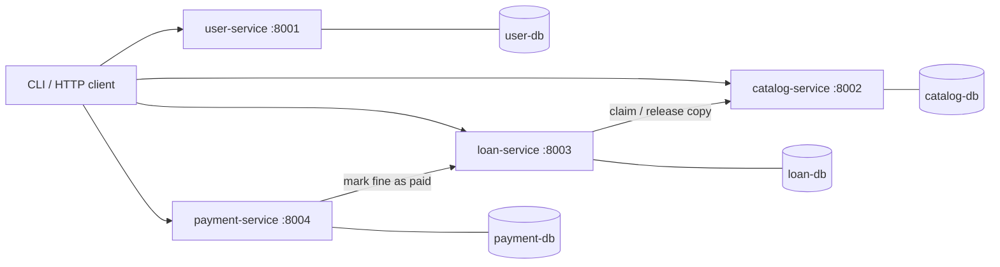
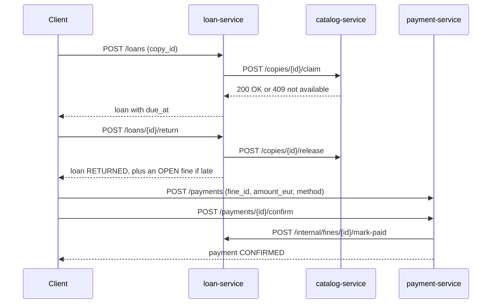

# BookLink

A library management system for a university, built as four small **FastAPI microservices** — users, catalog, loans and payments — each with its own PostgreSQL database, orchestrated with Docker Compose and usable from a command-line client.

BookLink models the core operations of a library: accounts and roles, book cataloguing, physical copy availability, loans, returns, late fines and (simulated) fine payments. Every service exposes interactive API docs through Swagger UI.

> Academic project. It is meant to demonstrate service boundaries, inter-service communication and JWT-based auth — not to run in production (see [Known limitations](#known-limitations)).

## Features

- **Authentication and roles** — registration and login with JWT; three roles: `student`, `docente` (lecturer) and `staff`
- **Catalog** — works (title, ISBN, year, language, subjects) and physical copies (barcode, shelf location); search by title, subject or ISBN
- **Loans** — borrow and return copies; loan period depends on the user's role
- **Late fines** — generated automatically when a book is returned after its due date
- **Payments** — simulated payment flow for fines (create → confirm → fine marked as paid)
- **CLI** — drive the whole flow from the terminal, no GUI needed

## Architecture



| Service | Port | Responsibility | Swagger UI |
|---|---|---|---|
| `user-service` | 8001 | Registration, login, user profiles, token issuing | [/docs](http://localhost:8001/docs) |
| `catalog-service` | 8002 | Works, copies and copy availability | [/docs](http://localhost:8002/docs) |
| `loan-service` | 8003 | Loans, returns, fines and loan rules | [/docs](http://localhost:8003/docs) |
| `payment-service` | 8004 | Payments for fines | [/docs](http://localhost:8004/docs) |

Design choices:

- **Database per service** — no service reads another service's tables; they talk over HTTP.
- **Stateless auth** — `user-service` issues the JWT; every other service validates it locally using the shared secret (`shared/auth.py`).
- **Atomic copy claiming** — to create a loan, `loan-service` asks `catalog-service` to move a copy from `AVAILABLE` to `LOANED` with a single conditional `UPDATE`. If the copy is already taken the request fails with `409` and no loan is created.
- **Internal endpoints** — service-to-service calls (e.g. marking a fine as paid) are protected by an `X-Internal-Token` header.

### Typical flow



## Tech stack

Python 3.12 · FastAPI · SQLAlchemy 2.0 · Psycopg 3 · PostgreSQL 16 · Pydantic v2 · python-jose (JWT) · passlib/bcrypt · HTTPX (service-to-service) · Docker & Docker Compose · Typer + Requests (CLI)

## Getting started

**Prerequisites:** Docker with Compose v2 (`docker compose`). Python 3.12+ is only needed if you want to run the CLI.

```bash
git clone https://github.com/Toroyoshi/BookLink.git
cd BookLink
docker compose up --build        # add -d to run in the background
```

Each API waits for its own database healthcheck before starting. Tables are created automatically on startup. Once everything is up, open any Swagger UI from the [services table](#architecture).

The four databases are also exposed on the host, one port per service:

| Database | Host port |
|---|---|
| `user-db` | 5433 |
| `catalog-db` | 5434 |
| `loan-db` | 5435 |
| `payment-db` | 5436 |

To stop the stack:

```bash
docker compose down
```

## Using the CLI

The CLI lives in `cli/booklink.py`. It talks to the local service URLs by default and stores your token in `~/.booklink_token.json`.

```bash
python -m venv .venv
source .venv/bin/activate        # Windows: .venv\Scripts\activate
pip install -r cli/requirements.txt
```

> If `--help` crashes with a `make_metavar` error, your `click` is too new for the pinned Typer version: run `pip install "click<8.2"`.

### Walkthrough

No account is pre-seeded. Register a staff user first (needed to add books); registering also logs you in.

```bash
python cli/booklink.py register --name "Staff" --email staff@uni.pt --password 1234 --role staff
python cli/booklink.py whoami
```

Add a work and a physical copy (both require `staff`):

```bash
python cli/booklink.py catalog-add-work --title "Clean Architecture" --isbn "9780134494166" --year 2017
python cli/booklink.py catalog-add-copy --work-id 1 --barcode "BC-0001" --location "Floor 1"
```

Switch to a student account, find the book and borrow it:

```bash
python cli/booklink.py register --name "Student" --email student@uni.pt --password 1234 --role student
python cli/booklink.py search "clean"
python cli/booklink.py loan --copy-id 1
python cli/booklink.py my-loans
```

Return it, then check fines and pay:

```bash
python cli/booklink.py return- --loan-id 1      # note the trailing dash in the command name
python cli/booklink.py fines
python cli/booklink.py pay --fine-id 1 --amount 1.00 --method card
```

A few things worth knowing:

- `register` and `login` both **replace** the stored token. Use `login --email ... --password ...` to switch between accounts.
- `pay` creates a `PENDING` payment and confirms it right away. Accepted methods: `card`, `mbway`, `cash`.
- A fine only exists if the loan was returned late. To see one without waiting two weeks, set `LOAN_DAYS_STUDENT: "-2"` in `docker-compose.yml` for `loan-service`, restart it, and borrow and return as a student — you get a €1.00 fine (2 days × €0.50). Revert it afterwards.

Prefer plain HTTP? Log in and pass the token as a bearer header:

```bash
TOKEN=$(curl -s -X POST http://localhost:8001/auth/login \
  -H "Content-Type: application/json" \
  -d '{"email":"staff@uni.pt","password":"1234"}' | jq -r .access_token)

curl -H "Authorization: Bearer $TOKEN" http://localhost:8003/loans
```

## API overview

| Service | Endpoint | Access |
|---|---|---|
| user | `POST /auth/register` · `POST /auth/login` | public |
| user | `GET /users/me` | authenticated |
| user | `GET /users/{id}` | `staff` |
| catalog | `GET /works?query=&isbn=` · `GET /works/{id}` | public |
| catalog | `POST /works` | `staff` |
| catalog | `GET /copies?work_id=` | public |
| catalog | `POST /copies/work/{work_id}` | `staff` |
| catalog | `POST /copies/{id}/claim` · `POST /copies/{id}/release` | internal use (called by loan-service) |
| loan | `POST /loans` · `GET /loans` · `POST /loans/{id}/return` | authenticated (own loans only) |
| loan | `GET /fines` | authenticated (own fines only) |
| loan | `POST /internal/fines/{id}/mark-paid` | internal token |
| payment | `POST /payments` · `GET /payments` · `POST /payments/{id}/confirm` | authenticated (own payments only) |

## Business rules

| Rule | Value | Env var |
|---|---|---|
| Loan period — student | 14 days | `LOAN_DAYS_STUDENT` |
| Loan period — docente | 30 days | `LOAN_DAYS_DOCENTE` |
| Loan period — staff | 30 days | `LOAN_DAYS_STAFF` |
| Late fine | €0.50 per day | `FINE_PER_DAY_EUR` |

A loan is due at 23:59:59 UTC on its due date. The fine is counted in calendar days (UTC) between the due date and the return date.

## Configuration

Everything is set through environment variables in `docker-compose.yml` (the business-rule variables above also live there). `DATABASE_URL` is required — a service will not start without it.

| Variable | Used by | Purpose | Default |
|---|---|---|---|
| `DATABASE_URL` | all | SQLAlchemy connection string for the service's own database | — (required) |
| `JWT_SECRET` | all | Token signing secret | `dev-secret-change-me` |
| `JWT_ALG` | all | Token signing algorithm | `HS256` |
| `TOKEN_EXPIRE_MINUTES` | user | Token lifetime | `240` |
| `INTERNAL_SERVICE_TOKEN` | loan, payment | Shared token for service-to-service calls | `internal-dev-token` |
| `CATALOG_SERVICE_URL` | loan | Where to reach `catalog-service` | `http://localhost:8002` |
| `LOAN_SERVICE_URL` | payment | Where to reach `loan-service` | `http://localhost:8003` |

These are development defaults. Change `JWT_SECRET`, `INTERNAL_SERVICE_TOKEN` and the database credentials for anything beyond local use.

## Project structure

```
BookLink/
├── docker-compose.yml   # four services + four PostgreSQL databases
├── shared/              # JWT helpers, DB session, settings (copied into each image)
├── user-service/        # app/routers: auth, users
├── catalog-service/     # app/routers: works, copies
├── loan-service/        # app/routers: loans, fines, internal  ·  app/rules.py
├── payment-service/     # app/routers: payments
└── cli/                 # Typer-based command-line client
```

Each service has its own `Dockerfile`, `requirements.txt` and `app/` package. The image build context is the repository root, which is how `shared/` ends up inside every image.

## Known limitations

This is a work in progress, and these are the gaps I know about:

- **Payments are simulated** — there is no payment gateway; `confirm` just flips the status.
- **Payment validation is still missing** — `POST /payments` does not yet check that the fine exists, belongs to the caller, is still `OPEN`, or that the amount matches. **Fixing this is the top priority.**
- **Cross-service operations are not atomic** — there is no retry or compensation if one side fails:
  - on payment confirmation, `loan-service` is updated before the payment is committed;
  - on loan creation, the copy is claimed before the loan is saved;
  - on return, a failed `release` call is ignored, so a copy can stay `LOANED`.
- **Role is chosen at registration** — anyone can register as `staff`.
- **Catalog `claim`/`release` have no auth** and all service ports are published; fine for local development, not for deployment.
- **Missing 404 handling** in some lookups by id (work, user, fine) — they currently return `500` for unknown ids.
- **No automated tests, no CI and no database migrations** — tables are created on startup with `create_all`.

## Roadmap

- [ ] Validate fines and amounts when creating a payment
- [ ] Make payment confirmation consistent across services (retry / compensation)
- [ ] Restrict who can register as `staff`; protect `claim`/`release`
- [ ] Proper 404 responses
- [ ] Alembic migrations
- [ ] Automated tests and CI
- [ ] Reservations with a waiting queue
- [ ] Events (e.g. RabbitMQ) to decouple payments from fines

## Author

**João Reis** — [@Toroyoshi](https://github.com/Toroyoshi)
