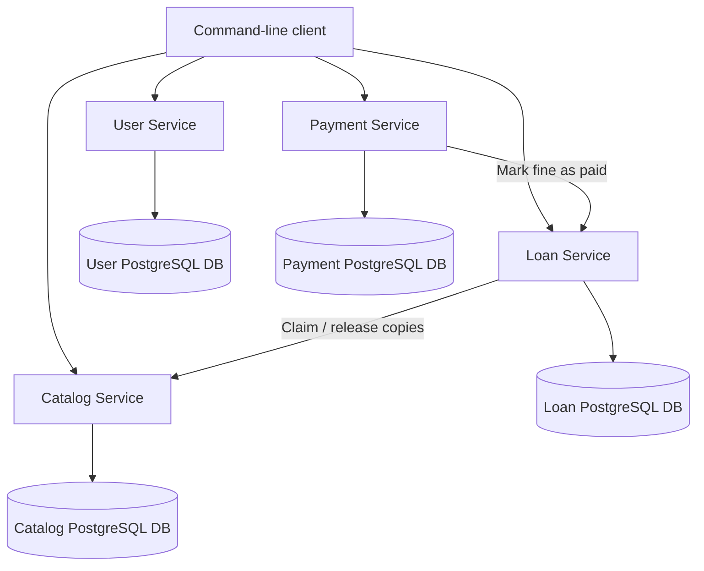

# BookLink

**A library management system built with Python, FastAPI, PostgreSQL and a microservices architecture.**

BookLink is a backend project that models the main operations of a library: user accounts, book cataloguing, physical copy availability, loans, returns, overdue fines and simulated fine payments. The system is split into independent REST services, each with its own PostgreSQL database, and can be run locally with Docker Compose.

The project exposes interactive API documentation through Swagger UI and includes a command-line client for testing common workflows without a graphical interface.

## Features

- **User management:** account registration, login and profile lookup.
- **JWT authentication:** access tokens are used to authenticate requests across the services.
- **Role-aware permissions:** cataloguing actions such as creating book records and physical copies are restricted to staff users.
- **Book catalog:** create and search book records using information such as title, ISBN, publication year, language and subject.
- **Copy tracking:** manage individual physical copies and their availability status.
- **Loans and returns:** borrow available copies, view personal loans and return borrowed items.
- **Overdue fines:** calculate fines when a book is returned after its due date.
- **Simulated payments:** create and confirm payments for outstanding fines.
- **Command-line interface:** exercise the main user, catalog, loan and payment flows from a terminal.

## Architecture

BookLink is organised as four FastAPI microservices. Each service owns its data and communicates with the other services through HTTP requests when a workflow crosses service boundaries.



### Services

| Service | Responsibility | Local API |
|---|---|---|
| `user-service` | Registration, login, JWT issuance and user profile endpoints | `http://localhost:8001` |
| `catalog-service` | Book records, physical copies and copy availability | `http://localhost:8002` |
| `loan-service` | Loans, returns, due dates and overdue fines | `http://localhost:8003` |
| `payment-service` | Payment records and payment confirmation | `http://localhost:8004` |

Each API has an interactive Swagger UI page at `/docs`.

### Key workflow: borrowing a book

1. A user requests a loan from `loan-service`.
2. `loan-service` asks `catalog-service` to claim the requested copy.
3. `catalog-service` changes the copy status from `AVAILABLE` to `LOANED` only when it is still available.
4. If the copy cannot be claimed, the loan is not created. Otherwise, `loan-service` creates the loan and calculates its due date based on the user's role.
5. When the book is returned, the copy is released and an overdue fine is created when applicable.

Payments follow a separate two-step flow: a payment is created with `PENDING` status and then confirmed. Confirmation is simulated; no external payment provider is connected.

## Technology stack

- **Language:** Python 3.12
- **API framework:** FastAPI
- **Data access:** SQLAlchemy
- **Validation and schemas:** Pydantic
- **Database:** PostgreSQL 16, with one database per service
- **Database driver:** Psycopg 3
- **Service-to-service communication:** HTTPX
- **Authentication:** JWT, with password hashing via Passlib and bcrypt
- **CLI:** Typer and Requests
- **Containers:** Docker and Docker Compose

## Project structure

```text
BookLink/
├── catalog-service/       # Book records and physical copies API
├── cli/                   # Command-line client
├── loan-service/          # Loans, returns and fines API
├── payment-service/       # Simulated payments API
├── shared/                # Shared database, authentication and settings code
├── user-service/          # Registration, login and user API
├── docker-compose.yml     # Services and PostgreSQL databases
└── README.md
```

Each service contains its own application code, dependency list and Dockerfile. The shared package provides common functionality used by the services.

## Getting started

### Prerequisites

- Docker Engine or Docker Desktop
- Docker Compose v2 (`docker compose`)
- Python 3.12 or newer, only if you want to run the CLI locally

### 1. Clone the repository

```bash
git clone https://github.com/Toroyoshi/BookLink.git
cd BookLink
```

### 2. Start the application

Build the service images and start all four APIs and their PostgreSQL databases:

```bash
docker compose up --build
```

To run the stack in the background instead:

```bash
docker compose up --build -d
```

Docker Compose waits for each database health check before starting its corresponding API service.

### 3. Open the API documentation

Once the containers are running, open the Swagger UI for the service you want to explore:

| Service | Swagger UI |
|---|---|
| User | [http://localhost:8001/docs](http://localhost:8001/docs) |
| Catalog | [http://localhost:8002/docs](http://localhost:8002/docs) |
| Loans | [http://localhost:8003/docs](http://localhost:8003/docs) |
| Payments | [http://localhost:8004/docs](http://localhost:8004/docs) |

The PostgreSQL databases are also mapped to the host on ports `5433`–`5436` (user, catalog, loan and payment, respectively).

### 4. Create a user and initialise sample data

The project does not require a pre-seeded account. You can register a local test account through the CLI (see the next section) or use the registration endpoint in the user service.

To create book records and physical copies, authenticate as a staff user. For a local demonstration, the current registration endpoint accepts a role in the registration payload. **Do not expose this setup publicly:** role assignment must be restricted to a trusted administrative process before deployment.

## Command-line interface

The CLI is located at `cli/booklink.py`. It uses the local service URLs by default and stores the latest access token in `~/.booklink_token.json`.

### Install CLI dependencies

From the repository root:

```bash
python -m venv .venv

# Linux / macOS
source .venv/bin/activate

# Windows PowerShell
# .venv\Scripts\Activate.ps1

pip install -r cli/requirements.txt
```

### Example workflow

**1. Register a staff account** (for local development only):

```bash
python cli/booklink.py register \
  --name "BookLink Admin" \
  --email "admin@booklink.local" \
  --password "change-me" \
  --role staff
```

**2. Add a book and a physical copy:**

```bash
python cli/booklink.py catalog-add-work \
  --title "Clean Architecture" \
  --isbn "9780134494166" \
  --year 2017

python cli/booklink.py catalog-add-copy \
  --work-id 1 \
  --barcode "BC-0001" \
  --location "Floor 1"
```

**3. Register a student account and borrow the copy:**

```bash
python cli/booklink.py register \
  --name "Library Student" \
  --email "student@booklink.local" \
  --password "change-me" \
  --role student

python cli/booklink.py search "clean"
python cli/booklink.py loan --copy-id 1
python cli/booklink.py my-loans
```

**4. Return a book:**

```bash
python cli/booklink.py return --loan-id 1
```

**5. View fines and simulate a payment:**

```bash
python cli/booklink.py fines
python cli/booklink.py pay --fine-id 1 --amount 0.50 --method card
```

The payment command requires both `--fine-id` and `--amount`. The example assumes that a fine already exists; a fine is generated when a loan is returned late.

### Other useful commands

```bash
python cli/booklink.py --help
python cli/booklink.py whoami
python cli/booklink.py login --email "student@booklink.local" --password "change-me"
```

Registering or logging in replaces the CLI's locally stored token. Use `login` to switch between accounts.

## Configuration

The development configuration is defined in `docker-compose.yml`. The following environment variables can be adjusted:

| Variable | Purpose | Development default |
|---|---|---:|
| `JWT_SECRET` | Secret used to sign JWTs | `dev-secret-change-me` |
| `JWT_ALG` | JWT signing algorithm | `HS256` |
| `TOKEN_EXPIRE_MINUTES` | Access-token lifetime | `240` |
| `FINE_PER_DAY_EUR` | Fine per overdue day | `0.50` |
| `LOAN_DAYS_STUDENT` | Loan period for students | `14` days |
| `LOAN_DAYS_DOCENTE` | Loan period for teaching staff | `30` days |
| `LOAN_DAYS_STAFF` | Loan period for library staff | `30` days |
| `INTERNAL_SERVICE_TOKEN` | Token for internal service requests | `internal-dev-token` |

These values are intended for local development. Replace the default secrets and database credentials before using the system in any shared or public environment.

## Current limitations and possible improvements

- Payment confirmation is simulated; there is no real payment gateway integration.
- A complete reservation and waiting-list workflow is not implemented yet.
- Database tables are currently created from SQLAlchemy metadata when each service starts; migration management with Alembic is a future improvement.
- Services communicate directly over HTTP; asynchronous events (for example, with RabbitMQ) could further decouple loan and payment workflows.
- The registration flow currently accepts the requested role from the client. Production use requires server-side role assignment and stricter access controls.

## Stopping the application

```bash
docker compose down
```

---

**BookLink** is a project focused on backend development, REST API design, database separation, service-to-service communication and containerised development environments.
